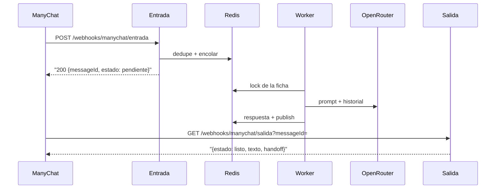

# Backend
Panel y cerebro de los bots de ManyChat. Orbita es una SaaS de IA para todo tipo de comercio. El frontend se describe en `frontend.md`.
El negocio es argentino. Cada cliente tiene su cuenta de ManyChat, su prompt y su plan. El flujo de ManyChat es el mismo para todos. El backend reconoce de qué número, cuenta o bot llegó el mensaje, abre una sola ficha y devuelve la respuesta para esa misma cuenta.
Si una empresa quiere una IA a medida, deja sus datos en el formulario de contacto. Eso abre un ticket que el equipo gestiona. Al contratar, el ticket se convierte en una ficha con plan Personalizado y abono mensual.
Hay dos accesos: el equipo (`/auth/login`, rol `admin`) y cada comercio (`/cuenta/*`, rol `cliente`). El comercio se registra solo, acepta Términos y Privacidad, paga y configura su IA con un tutorial.
## Stack
- Node.js 22 + TypeScript, Fastify 5, zod.
- PostgreSQL 16 con Prisma: fichas, canales, planes, uso, conversaciones, pagos, tickets y turnos.
- Redis 7: cola de mensajes (BullMQ), lock por ficha, dedupe de 30 segundos, respuestas pendientes (Pub/Sub), contadores de uso y rate limit.
- Dos procesos con la misma imagen: `api` (`dist/server.js`) y `worker` (`dist/worker.js`).
- Tests con Vitest: unitarios y de integración contra Postgres y Redis reales (testcontainers).
## Qué hace
- Recibir el mensaje que reenvía el flujo de ManyChat (entrada) y contestar en menos de un segundo con un `messageId`.
- Resolver el cliente por el extremo que recibió el mensaje.
- Armar la respuesta en el worker con el prompt de esa ficha y los módulos prendidos, llamando a OpenRouter.
- Entregar el texto cuando ManyChat lo pide (salida, long-poll de hasta 8 segundos).
- Contar cada respuesta del bot y frenar al llegar al tope del plan.
- Cobrar el abono (Mercado Pago a 18 días, o transferencia) y pausar la ficha si no se pagó.
- Recibir tickets de IA personalizada y convertirlos en fichas.
- Registrar comercios, guardar la aceptación de los documentos legales y guiar el onboarding hasta activar la IA.
- Dar al equipo los KPIs del negocio (MRR, cobranza, uso, embudo, alertas).
## Qué queda afuera
- Crear o editar flujos de ManyChat. La API no lo permite. El flujo plantilla se arma una vez en el constructor y el cliente lo instala en su cuenta.
- Conectar Instagram, WhatsApp o Telegram. Eso lo hace el cliente en su ManyChat. WhatsApp pide el plan Pro de ManyChat y la billetera de Meta es de él.
- Pagar ManyChat, los mensajes de Meta o Ingresos Brutos. El neto de cada plan es lo que entra después de la comisión de Mercado Pago. IIBB se confirma con el primer cobro real.
- Un modelo distinto por cliente. El default es un modelo barato. Uno más capaz se habilita en la ficha solo si el plan lo paga (Completo y Personalizado).
## Límites de ManyChat que el código tiene que respetar
- Una cuenta de ManyChat es un bot. Una clave no salta de una cuenta a otra. Cada ficha guarda su propio `appToken`, cifrado con AES-256-GCM.
- External Request corta a los 10 segundos. Por eso hay dos endpoints: la entrada responde enseguida y la salida espera como máximo `LONG_POLL_MS` (8 segundos).
- Los recordatorios no responden a un mensaje entrante y salen por `POST /fb/sending/sendContent` con `Authorization: Bearer <appToken>` de la ficha.
- Tope de envío de ManyChat: unos 25 `sendContent` por segundo por cuenta. Con el volumen de estos planes no se acerca.
## Estructura
```text
Backend/
  Dockerfile
  prisma/
    schema.prisma
    migrations/
  src/
    server.ts           # API (Fastify)
    worker.ts           # BullMQ: generación, recordatorios y cobros
    app.ts  deps.ts  config.ts
    admin/              # JWT por rol (admin / cliente), login del equipo, métricas
    cuenta/             # registro, login y panel del comercio, onboarding
    legal/              # versiones vigentes y aceptaciones
    messaging/          # entrada, salida, respuestas en Redis, cliente ManyChat
    ai/                 # contexto, perfil guiado -> prompt, simulador, cliente OpenRouter
    worker/             # procesamiento de cada mensaje
    billing/            # planes, Mercado Pago, transferencia, pausa
    usage/              # topes diario, semanal y mensual
    tickets/            # IA personalizada
    modules/
      faq/              # responder con el prompt
      handoff/          # pasar a una persona
      turnos/           # sacar, consultar y cancelar
      recordatorios/    # confirmación y aviso del día anterior
    tenants/            # alta, edición, índice endpointId -> clientId, página pública
    lib/                # fechas por zona horaria, cifrado, lock, rate limit, claves Redis
  test/
    unit/
    integration/
```
El código de cada módulo existe una sola vez en `src/modules`. Prender turnos en un cliente es incluir `turnos` en `Tenant.modulos`.
## Ficha (tabla `Tenant`)
| Campo | Qué es |
|---|---|
| `id` | `clientId`, por ejemplo `pizzeria-norte` |
| `estado` | `activo` o `pausado`. Pausado no llama a OpenRouter y no contesta. |
| `pausaMotivo` | `manual`, `impago` u `onboarding` (registrada y sin terminar el tutorial) |
| `planId` | `mensajes`, `turnos`, `completo` o `personalizado` |
| `timezone` | default `America/Argentina/Buenos_Aires` |
| `pageId`, `appTokenEnc` | datos de ManyChat; el token va cifrado. Vacíos hasta que el comercio los carga en el tutorial |
| `rubro`, `perfil` | datos del registro y respuestas del tutorial; `perfil` se compila en `prompt` |
| `onboardingPaso`, `onboardingCompletado` | progreso del tutorial y fecha de activación |
| `apiKey` | secreto que el flujo manda en `X-Orbita-Key` |
| `prompt` | qué vende, precios, horarios, tono y cuándo pasar a una persona |
| `mensajes` | textos fijos sin modelo: `espera`, `tope`, `handoff`, `recordatorio` |
| `modulos`, `topeDia`, `topeSemana`, `topeMes` | se copian del plan al dar de alta |
| `precioPersonalizado` | abono acordado en el ticket (solo plan Personalizado) |
| `publicToken` | token de la página `/p/:token` |
Relacionadas: `Channel` (extremos), `Subscription` (medio, estado del pago, día del abono, vencimiento), `Payment`, `Usage`, `Conversation` (últimas 10 intervenciones por contacto), `Turno`, `Ticket`, `ClientUser` (cuenta del comercio, una por ficha) y `LegalAcceptance`.
## Planes
| Plan | Transferencia | Mercado Pago | Topes día/semana/mes | Canales | Módulos |
|---|---|---|---|---|---|
| Mensajes | $40.000 | $42.000 | 100 / 500 / 2.000 | 1 | faq, handoff |
| Turnos | $80.000 | $84.000 | 200 / 1.000 / 4.000 | 2 | + turnos |
| Completo | $110.000 | $115.000 | 400 / 2.000 / 8.000 | 3 | + recordatorios, modelo capaz |
| Personalizado | acordado | acordado | 1.000 / 5.000 / 20.000 (editables) | 5 | a medida |
Viven en `src/billing/plans.ts` y se cargan en la tabla `Plan` al arrancar la API. Cambiar de plan reescribe módulos y topes.
## Enrutado
La clave es el extremo al que le escribieron, nunca el teléfono de la persona.
| Canal | Campo | Ejemplo |
|---|---|---|
| WhatsApp | `phone_number_id` del número del negocio | el número del local |
| Instagram | `page_id` de esa cuenta | la cuenta del local |
| Telegram | id del bot | el bot del local |
Esas claves viven en `Channel.endpointId` (único) y se indexan en el hash de Redis `idx:endpoints` (`endpointId -> clientId`). El índice se reconstruye al arrancar y cada vez que cambian los canales. Si llega un extremo que no está en ninguna ficha, se responde `200` con `estado: "ignorado"`.
## Entrada y salida

### `POST /webhooks/manychat/entrada`
Header `X-Orbita-Key: <apiKey de la ficha>`. Cuerpo que manda el flujo plantilla:
```json
{
  "pageId": "123",
  "subscriberId": "999",
  "canal": "whatsapp",
  "endpointId": "54911XXXX",
  "texto": "tienen mesa para dos el sábado?",
  "nombre": "Ana"
}
```
Pasos, en este orden:
1. Validar el JSON. Si es inválido, `400`.
2. Buscar la ficha por `endpointId`. Tiene que coincidir también el `pageId`. Si no coincide, `200` con `estado: "ignorado"`.
3. Validar `X-Orbita-Key`. Si no coincide, `401`.
4. Si la ficha está `pausado`, `estado: "ignorado"`.
5. Deduplicar. La clave es `pageId + subscriberId + texto` durante 30 segundos. Un reintento de ManyChat recibe el mismo `messageId` y no genera otra respuesta ni otro consumo.
6. Si el tope diario, semanal o mensual ya se cumplió, devolver `estado: "listo"` con `messages.tope`. Ese texto fijo no llama a OpenRouter y no suma al contador.
7. Guardar `resp:<messageId>` como pendiente (TTL 10 minutos) y encolar la generación.
Respuesta: `{ "ok": true, "messageId": "uuid", "estado": "pendiente" | "listo" | "ignorado", "texto": "" }`.
### `GET /webhooks/manychat/salida?messageId=<uuid>`
Header `X-Orbita-Key`. Si la respuesta ya está lista, vuelve al instante. Si no, espera por Pub/Sub hasta `LONG_POLL_MS` (default 8000, máximo 9000) o lo que pida `esperaMs`, si es menor.
Respuesta: `{ "ok": true, "messageId": "...", "estado": "listo" | "pendiente" | "ignorado", "texto": "...", "handoff": false }`. Si el `messageId` no existe o venció, `404`.
### Flujo plantilla en ManyChat
1. External Request a la entrada. Guardar `$.messageId` y `$.estado` en custom fields.
2. Si `estado` es `listo`, enviar `$.texto`. Si es `ignorado`, no hacer nada.
3. Si es `pendiente`, External Request a la salida con el `messageId`. Si vuelve `pendiente`, Smart Delay corto y reintentar, con un máximo de 3 vueltas. Si sigue pendiente, enviar el texto de handoff.
4. Si `handoff` es `true`, además de enviar el texto, marcar la conversación para un humano (Live Chat).
### Worker
1. Toma el lock de esa ficha (`lock:tenant:<id>`, con expiración).
2. Vuelve a leer estado y topes.
3. Arma el contexto con el `prompt`, las instrucciones de los módulos prendidos, la fecha y hora del negocio y el historial corto del contacto (últimas 10 intervenciones).
4. Llama a OpenRouter con el modelo de la ficha.
5. Pasa la salida por los módulos: `turnos` interpreta `[TURNO_RESERVAR AAAA-MM-DD HH:mm]` y `[TURNO_CANCELAR id]`, y `handoff` reemplaza `[HANDOFF]` por `messages.handoff`.
6. Suma 1 al uso del día, de la semana y del mes (Redis + Postgres).
7. Guarda el historial, completa `resp:<messageId>` y publica el aviso para los long-polls.
8. Suelta el lock.
Si OpenRouter falla, se reintenta una vez. Si vuelve a fallar, la respuesta es `messages.handoff` y no se suma uso.
Tareas programadas del worker: `recordatorios` cada 15 minutos (aviso del día anterior por `sendContent`) y `cobros` cada hora.
## Uso y topes
Los períodos se calculan en la zona horaria de la ficha: el día reinicia a medianoche, la semana el lunes y el mes el día del abono (si el abono es el 31, en los meses cortos cae el último día).
## Cobros
- Alta: la suscripción arranca `pendiente` con vencimiento en la fecha del alta. El día del abono es el día del alta.
- Transferencia: el equipo marca el pago y el vencimiento se corre un mes.
- Mercado Pago: la página del cliente crea la suscripción (`preapproval`) y el cliente la aprueba una vez. `POST /webhooks/mercadopago` valida la firma `x-signature`, consulta el pago y lo registra una sola vez. La acreditación se estima a 18 días.
- Cada hora: vencido pasa a `pendiente`. Con 7 días de atraso pasa a `impago` y la ficha se pausa con motivo `impago`. Registrar el pago la reactiva.
- Activar a mano solo se permite con el pago al día.
- Cambiar de plan o de medio limpia la suscripción de Mercado Pago guardada y cancela la anterior (`PUT /preapproval/:id`), para no cobrar dos veces ni con el importe viejo.
## Cuentas de los comercios
- `POST /cuenta/registro`: negocio, rubro, nombre, email, contraseña (mínimo 8), plan (`mensajes`, `turnos` o `completo`), medio, `aceptaTerminos: true` y `aceptaPrivacidad: true`. Crea la ficha pausada con motivo `onboarding`, la suscripción `pendiente`, el usuario y las aceptaciones. El `clientId` sale del nombre del negocio. Límite de 5 por hora por IP.
- Contraseñas con scrypt. JWT de cliente `{ sub, rol: 'cliente', tenantId }` por 7 días; el del equipo es `{ sub, rol: 'admin' }` por 12 horas. Cada lado rechaza el token del otro con `403`.
- Restablecer: el equipo genera un link de un solo uso válido 24 h (`POST /clientes/:id/reset-password`). Se guarda solo el hash del token.
- Fichas creadas por el equipo (alta o ticket): `POST /clientes/:id/acceso` crea el usuario y devuelve el mismo tipo de link para que elija contraseña.
## Documentos legales
- `LEGAL` en `src/legal/legal.ts` tiene la versión vigente de `terminos` y `privacidad` (hoy `2026-11-14`). Tiene que coincidir con `VERSION_LEGAL` del frontend.
- Cada aceptación guarda usuario, documento, versión, IP, user agent y fecha. Es la prueba de la aceptación electrónica.
- Si la versión aceptada no es la vigente, todo `/cuenta/*` responde `428` salvo `GET /cuenta/me` (que lista `legalPendiente`) y `POST /cuenta/legal/aceptar`. Publicar una versión nueva es cambiar la fecha en `LEGAL` y en el frontend.
- El formulario de contacto y el botón de arrepentimiento exigen `aceptaPrivacidad: true` y guardan la versión y la IP en el ticket.
## Onboarding
- Requisitos para activar: pago al día, ManyChat cargado, al menos un canal y prompt no vacío. `POST /cuenta/onboarding/completar` responde `409` con lo que falta o activa la ficha.
- `PUT /cuenta/perfil` recibe las respuestas del tutorial (descripción, productos, horarios, ubicación, pagos y envíos, tono, cuándo derivar, preguntas frecuentes y, si el plan tiene turnos, servicios, horarios, duración y anticipación) y las compila en el prompt por secciones. El prompt se puede editar a mano después.
- `POST /cuenta/probar` es el simulador: usa el prompt y los módulos reales pero no reserva turnos, no suma uso ni guarda historial; devuelve el texto y las acciones que haría. Pide el pago al día y tiene un límite de 60 por hora.
- El comercio puede pausar y reactivar su IA una vez terminado el tutorial. Reactivar pide el pago al día.
## Métricas
`GET /admin/metricas` (solo equipo) devuelve:
- clientes: total, activos, pausados por motivo, en onboarding y por plan;
- ingresos: MRR y ARPU de los que pagan, MRR en riesgo, cobrado en 30 días, por acreditar y total por mes (6 meses);
- cobranza por estado de pago, respuestas por día (30 días), embudo de registro, tickets por estado, conversión y arrepentimientos abiertos;
- alertas: clientes con 80% o más del tope mensual y vencimientos de los próximos 7 días.
## Tickets
- `POST /publico/contacto`: nombre, email, teléfono, empresa, rubro, necesidad y aceptación de privacidad. Tiene honeypot (`website`) y un límite de 5 envíos por hora por IP.
- `POST /publico/arrepentimiento` (Res. 424/2020): nombre, email, negocio y motivo opcionales. Crea un ticket de tipo `arrepentimiento` y devuelve su id como código de trámite. Esos tickets no se convierten en fichas.
- `GET /tickets?estado=&tipo=`, `GET /tickets/:id` y `PATCH /tickets/:id` para estado (`nuevo`, `en_gestion`, `cotizado`, `descartado`), importe mensual y notas.
- `POST /tickets/:id/convertir`: pide los datos de la ficha (clientId, canales, ManyChat, prompt, medio). Crea la ficha con plan Personalizado al importe del ticket y deja el ticket como `contratado`.
## API del panel
Todas con `Authorization: Bearer <jwt>` de `POST /auth/login` (credenciales `ADMIN_EMAIL` / `ADMIN_PASSWORD`).
| Método | Ruta |
|---|---|
| GET | `/planes`, `/admin/metricas` |
| GET, POST | `/clientes` |
| GET, PATCH | `/clientes/:id` |
| PUT | `/clientes/:id/prompt` |
| POST | `/clientes/:id/pausar`, `/activar`, `/transferencia`, `/reset-password`, `/acceso` |
| GET | `/clientes/:id/uso`, `/turnos`, `/pagos` |
| GET, PATCH, POST | `/tickets`, `/tickets/:id`, `/tickets/:id/convertir` |
## API del comercio
Con el JWT de `POST /cuenta/login` o `/cuenta/registro`.
| Método | Ruta |
|---|---|
| GET | `/cuenta/me`, `/cuenta/uso`, `/cuenta/turnos`, `/cuenta/pagos` |
| POST | `/cuenta/legal/aceptar`, `/cuenta/password`, `/cuenta/suscripcion`, `/cuenta/onboarding`, `/cuenta/onboarding/completar`, `/cuenta/pausar`, `/cuenta/activar`, `/cuenta/probar` |
| PUT | `/cuenta/perfil`, `/cuenta/prompt`, `/cuenta/canales`, `/cuenta/manychat` |
| PATCH | `/cuenta/plan`, `/cuenta/textos` |
Públicas: `POST /cuenta/registro`, `/cuenta/login`, `/cuenta/restablecer`, `GET /publico/planes`, `/publico/legal`, `/publico/:token`, `POST /publico/:token/suscripcion`, `/publico/contacto`, `/publico/arrepentimiento`, `GET /health`.
## Correr
```bash
cp .env.example .env        # completar secretos
docker compose up -d --build
```
- Sitio y paneles: `http://localhost:${WEB_PORT}` (8080 en el `.env` actual; nginx hace proxy de `/api` a la API).
- API directa: `http://localhost:3000`.
- Las migraciones de Prisma corren al iniciar `api`; el `worker` arranca cuando la API está sana.
Desarrollo local: `npm run dev` y `npm run dev:worker` en `Backend/` con Postgres y Redis del compose.
## Tests y calidad
- `npm test` en `Backend/` corre unitarios e integración (necesita Docker para testcontainers). `npm run test:unit` corre solo los unitarios.
- `npm run test:coverage` en la raíz genera la cobertura de backend y frontend.
