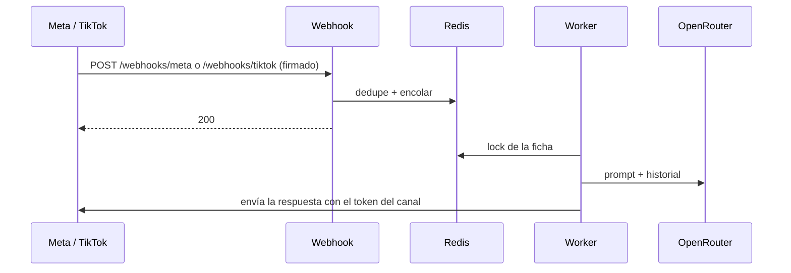

# Backend
Panel y cerebro de los asistentes de IA que atienden WhatsApp, Instagram, TikTok y la web del comercio. Orbita es una SaaS de IA para todo tipo de comercio. El frontend se describe en `frontend.md`.
El negocio es argentino. Cada cliente conecta sus canales con su token, carga su prompt y elige su plan. Meta y TikTok mandan los mensajes a los webhooks de Orbita (uno por plataforma, configurado una sola vez a nivel app). El backend reconoce a qué número o cuenta le escribieron, abre la ficha de ese comercio y contesta por la API de esa misma plataforma.
Si una empresa quiere una IA a medida, deja sus datos en el formulario de contacto. Eso abre un ticket que el equipo gestiona. Al contratar, el ticket se convierte en una ficha con plan Personalizado y abono mensual.
Hay dos accesos: el equipo (`/auth/login`, rol `admin`) y cada comercio (`/cuenta/*`, rol `cliente`). El comercio se registra solo, acepta Términos y Privacidad, paga y configura su IA con un tutorial.
## Stack
- Node.js 22 + TypeScript, Fastify 5, zod.
- PostgreSQL 16 con Prisma: fichas, canales, planes, uso, conversaciones, pagos, tickets y turnos.
- Redis 7: cola de mensajes (BullMQ), lock por ficha, dedupe de 24 horas por id de mensaje, contadores de uso y rate limit.
- Dos procesos con la misma imagen: `api` (`dist/server.js`) y `worker` (`dist/worker.js`).
- Tests con Vitest: unitarios y de integración contra Postgres y Redis reales (testcontainers).
## Qué hace
- Recibir los webhooks de Meta (WhatsApp e Instagram) y de TikTok, validar la firma, encolar y contestar `200` enseguida.
- Resolver el cliente por el extremo que recibió el mensaje.
- Armar la respuesta en el worker con el prompt de esa ficha y los módulos prendidos, llamando a OpenRouter.
- Enviar la respuesta por la API de la plataforma con el token del canal.
- Contestar en la web del comercio (widget o API directa) en el mismo pedido HTTP.
- Al derivar a una persona, silenciar la IA en esa conversación y avisar por mail al comercio.
- Contar cada respuesta del bot y frenar al llegar al tope del plan.
- Cobrar el abono con Mercado Pago (acredita a los 18 días) y pausar la ficha si no se pagó.
- Recibir tickets de IA personalizada y convertirlos en fichas.
- Registrar comercios, guardar la aceptación de los documentos legales y guiar el onboarding hasta activar la IA.
- Dar al equipo los KPIs del negocio (MRR, cobranza, uso, embudo, alertas).
## Qué queda afuera
- Conectar las cuentas por OAuth (Embedded Signup de Meta, autorización de TikTok). Por ahora el comercio pega el id del extremo y su token en el panel.
- Renovar tokens. Los de TikTok duran poco; si vence, el envío falla y queda en el log como `error_envio`.
- Plantillas de WhatsApp. Fuera de la ventana de 24 horas Meta solo acepta plantillas aprobadas; hoy se manda texto libre.
- Pagar los mensajes de Meta o Ingresos Brutos. El neto de cada plan es lo que entra después de la comisión de Mercado Pago. IIBB se confirma con el primer cobro real.
- Un modelo distinto por cliente. El default es un modelo barato. Uno más capaz se habilita en la ficha solo si el plan lo paga (Completo y Personalizado).
## Límites de las plataformas que el código tiene que respetar
- Cada canal guarda su propio token en `Channel.tokenEnc`, cifrado con AES-256-GCM. La API nunca lo devuelve: solo `conectado` y una máscara.
- WhatsApp Cloud API: texto libre solo dentro de las 24 horas desde el último mensaje del cliente. Máximo 4096 caracteres por mensaje; lo más largo se parte.
- Instagram (API con Instagram Login): respuestas solo dentro de las 24 horas. Máximo 1000 bytes UTF-8 por mensaje.
- TikTok Business Messaging: hasta 10 mensajes por conversación cada 48 horas desde el último mensaje del cliente. Solo cuentas Business y solo en algunas regiones.
- Meta reintenta un webhook si no recibe `200`. Por eso se responde enseguida, se deduplica por id de mensaje y los errores de una ficha no cortan el resto del lote.
- Los recordatorios no responden a un mensaje entrante: salen por el mismo canal de la última conversación y están sujetos a las mismas ventanas.
## Estructura
```text
Backend/
  Dockerfile
  prisma/
    schema.prisma
    migrations/
  src/
    server.ts           # API (Fastify)
    worker.ts           # BullMQ: generación, recordatorios y cobros
    app.ts  deps.ts  config.ts
    admin/              # JWT por rol (admin / cliente), login del equipo, métricas
    cuenta/             # registro, login y panel del comercio, onboarding
    legal/              # versiones vigentes y aceptaciones
    messaging/          # webhooks de Meta y TikTok, firmas, encolado y envío por cada plataforma
    ai/                 # contexto, perfil guiado -> prompt, simulador, cliente OpenRouter
    demo/               # demo gratis: fuentes (PDF, TSV/CSV, texto), funciones simuladas y chat
    worker/             # procesamiento de cada mensaje
    web/                # integración web: endpoint público, widget.js y contacto
    billing/            # planes, Mercado Pago, transferencia, pausa
    usage/              # topes diario, semanal y mensual
    tickets/            # IA personalizada
    modules/
      faq/              # responder con el prompt
      handoff/          # pasar a una persona
      turnos/           # sacar, consultar y cancelar
      recordatorios/    # confirmación y aviso del día anterior
    tenants/            # alta, edición, índice endpointId -> clientId, página pública
    lib/                # fechas por zona horaria, cifrado, lock, rate limit, claves Redis
  test/
    unit/
    integration/
```
El código de cada módulo existe una sola vez en `src/modules`. Prender turnos en un cliente es incluir `turnos` en `Tenant.modulos`.
## Ficha (tabla `Tenant`)
| Campo | Qué es |
|---|---|
| `id` | `clientId`, por ejemplo `pizzeria-norte` |
| `estado` | `activo` o `pausado`. Pausado no llama a OpenRouter y no contesta. |
| `pausaMotivo` | `manual`, `impago` u `onboarding` (registrada y sin terminar el tutorial) |
| `planId` | `mensajes`, `turnos`, `completo` o `personalizado` |
| `timezone` | default `America/Argentina/Buenos_Aires` |
| `rubro`, `perfil` | datos del registro y respuestas del tutorial; `perfil` se compila en `prompt` |
| `onboardingPaso`, `onboardingCompletado` | progreso del tutorial y fecha de activación |
| `emailContacto` | a dónde llega el aviso cuando la IA deriva a una persona |
| `prompt` | qué vende, precios, horarios, tono y cuándo pasar a una persona |
| `mensajes` | textos fijos sin modelo: `espera`, `tope`, `handoff`, `recordatorio` |
| `modulos`, `topeDia`, `topeSemana`, `topeMes` | se copian del plan al dar de alta |
| `precioPersonalizado` | abono acordado en el ticket (solo plan Personalizado) |
| `publicToken` | token de la página `/p/:token` |
| `webActiva`, `webClave`, `webOrigenes`, `webBienvenida`, `webColor` | integración web: si está prendida, su clave pública, los dominios permitidos y cómo se ve el chat |
| `demo` | configuración de la demo (`negocio`, `funciones`, `horarios`, `tono`) y cuántos mensajes se probaron |
Relacionadas: `DemoFuente` (archivos y textos cargados en la demo), `Channel` (extremo y token cifrado), `Subscription` (medio, estado del pago, día del abono, vencimiento), `Payment`, `Usage`, `Conversation` (canal, extremo, destino para responder, `handoffHasta` y últimas 10 intervenciones por contacto), `Turno`, `Ticket`, `ClientUser` (cuenta del comercio, una por ficha) y `LegalAcceptance`.
## Planes
| Plan | Transferencia | Mercado Pago | Topes día/semana/mes | Canales | Módulos |
|---|---|---|---|---|---|
| Mensajes | $40.000 | $42.000 | 100 / 500 / 2.000 | 1 | faq, handoff |
| Turnos | $80.000 | $84.000 | 200 / 1.000 / 4.000 | 2 | + turnos |
| Completo | $110.000 | $115.000 | 400 / 2.000 / 8.000 | 3 | + recordatorios, modelo capaz |
| Personalizado | acordado | acordado | 1.000 / 5.000 / 20.000 (editables) | 5 | a medida |
Viven en `src/billing/plans.ts` y se cargan en la tabla `Plan` al arrancar la API. Cambiar de plan reescribe módulos y topes.
## Enrutado
La clave es el extremo al que le escribieron, nunca el teléfono de la persona.
| Canal | `endpointId` | Token | Destino para responder |
|---|---|---|---|
| WhatsApp | `phone_number_id` del número del negocio | token de acceso de la Cloud API (usuario del sistema) | número de la persona (`wa_id`) |
| Instagram | id de la cuenta profesional de Instagram | token de Instagram Login | IGSID de la persona |
| TikTok | `business_id` de la cuenta Business | `access_token` de Business Messaging | `conversation_id` |
Esas claves viven en `Channel.endpointId` (único) y se indexan en el hash de Redis `idx:endpoints` (`endpointId -> clientId`). El índice se reconstruye al arrancar y cada vez que cambian los canales. Si llega un extremo que no está en ninguna ficha, se ignora.
Un canal cuenta como conectado cuando tiene token. Editar los canales sin mandar `token` conserva el que ya estaba para el mismo tipo y extremo.
## Webhooks

Se configuran una sola vez, en la app de Orbita de cada plataforma, con la URL pública (`{PUBLIC_URL}/api/...`; nginx saca el `/api`).
### `GET /webhooks/meta`
Verificación de Meta: si `hub.mode` es `subscribe` y `hub.verify_token` coincide con `META_VERIFY_TOKEN`, devuelve `hub.challenge`. Si no, `403`.
### `POST /webhooks/meta`
Un solo endpoint para WhatsApp (`object: whatsapp_business_account`, campo `messages`) e Instagram (`object: instagram`, campo `messages`).
1. Valida `X-Hub-Signature-256` (HMAC-SHA256 del cuerpo crudo con `META_APP_SECRET`). Sin secreto configurado, `503`; firma inválida, `401`.
2. Lee solo los mensajes de texto. Descarta ecos, mensajes borrados, estados de entrega y lo que manda la propia cuenta.
3. Por cada mensaje, `recibirMensaje` (abajo). Responde siempre `200 { ok: true }` para que Meta no reintente; los errores quedan en el log.
### `POST /webhooks/tiktok`
Suscripción a `DIRECT_MESSAGE` a nivel app (`/business/webhook/update/`).
1. Valida `TikTok-Signature: t=<seg>,s=<hex>`, HMAC-SHA256 de `"<t>.<cuerpo>"` con `TIKTOK_APP_SECRET`, con 5 minutos de tolerancia.
2. Acepta solo `event: im_receive_msg` de tipo texto enviado por una cuenta personal. `user_openid` es el extremo y `conversation_id` el destino.
3. Igual que Meta: `recibirMensaje` y `200`.
### `recibirMensaje`
1. Busca la ficha por el extremo. Si no existe, el tipo de canal no coincide o la ficha está pausada, se ignora.
2. Deduplica por id del mensaje de la plataforma durante 24 horas: los reintentos no generan otra respuesta ni otro consumo.
3. Guarda en `Conversation` el canal, el extremo, el destino y el nombre de la persona.
4. Si la conversación está derivada (`handoffHasta` en el futuro), se ignora: la atiende una persona.
5. Encola la generación (3 intentos con espera exponencial).
### Worker
1. Toma el lock de esa ficha (`lock:tenant:<id>`, con expiración). Si no lo consigue, el job se reintenta.
2. Vuelve a leer estado y topes. Si se cumplió el tope diario, semanal o mensual, la respuesta es `messages.tope`, no llama a OpenRouter y deriva.
3. Arma el contexto con el `prompt`, las instrucciones de los módulos prendidos, la fecha y hora del negocio y el historial corto del contacto (últimas 10 intervenciones).
4. Llama a OpenRouter con el modelo de la ficha, con el razonamiento apagado (los modelos que razonan gastan el `max_tokens` pensando y pueden devolver vacío).
5. Pasa la salida por los módulos: `turnos` interpreta `[TURNO_RESERVAR AAAA-MM-DD HH:mm]` y `[TURNO_CANCELAR id]`, y `handoff` reemplaza `[HANDOFF]` por `messages.handoff`.
6. Suma 1 al uso del día, de la semana y del mes (Redis + Postgres) y guarda el historial.
7. Si hay que derivar: `handoffHasta = ahora + HANDOFF_HORAS` (12 por defecto) y mail a `emailContacto` con el último mensaje.
8. Envía la respuesta por la API de la plataforma (WhatsApp Cloud API, Instagram Graph API o TikTok Business API), partida si supera el largo máximo. Si el canal no tiene token, queda `sin_canal`; si la plataforma rechaza el envío, `error_envio` en el log.
9. Suelta el lock.
Si OpenRouter falla, se reintenta una vez. Si vuelve a fallar, la respuesta es `messages.handoff`, se deriva y no se suma uso.
Tareas programadas del worker: `recordatorios` cada 15 minutos (aviso del día anterior por el canal de la última conversación) y `cobros` cada hora.
## Integración web
Para poner la IA en cualquier sitio (HTML propio, WordPress, Shopify, Tiendanube, Wix, Google Tag Manager) o llamarla desde otro sistema. No usa la cola: responde en el mismo pedido, con el mismo lock, topes, módulos e historial que el worker.
- El comercio la prende con `PUT /cuenta/web` (`activa`, `origenes`, `bienvenida`, `color`). La primera vez se genera `webClave` (`web_` + 24 caracteres). `POST /cuenta/web/clave` la rota y la anterior deja de andar. Las dos piden el pago al día.
- `GET /cuenta/me` devuelve `web` con la clave, el `endpoint` y el `script` listo para pegar: `<script src="<PUBLIC_URL>/api/web/widget.js" data-clave="..." async></script>`.
- La clave es pública (va en el HTML). `webOrigenes` limita desde qué dominios puede usarla un navegador: se guarda el hostname sin `www.` y cada dominio habilita sus subdominios. Vacío es cualquier sitio. Las llamadas sin `Origin` (servidor a servidor) se aceptan.
- CORS: las rutas `/web/*` aceptan cualquier origen; el dominio lo valida la ruta (`403` si no está permitido). El resto de la API sigue limitada a `CORS_ORIGIN`.
| Método | Ruta | Qué hace |
|---|---|---|
| GET | `/web/widget.js` | El chat (JS sin dependencias, Shadow DOM). Opciones: `data-posicion="izquierda"`, `data-abierto="true"`; API `Orbita.abrir()`, `cerrar()`, `enviar(texto)`. Cache 1 hora. |
| GET | `/web/:clave` | `{ negocio, bienvenida, color, disponible }`. 120 por minuto por IP. |
| POST | `/web/:clave/mensajes` | `{ sesion, texto, nombre? }` → `{ estado, texto, handoff }`. `sesion` (8 a 64 letras, números, `-` o `_`) identifica a la persona; el historial se guarda como `web:<sesion>`. `estado` es `respondido`, `tope` o `no_disponible` (ficha pausada, sin llamar a la IA). 30 por minuto por IP y 12 por minuto por sesión. |
| POST | `/web/:clave/contacto` | `{ sesion, contacto, nombre? }`. Cuando hubo `handoff`, manda al comercio el contacto y la charla reciente por mail. 5 por hora por IP. |
Si la IA deriva, la respuesta trae `handoff: true` y el widget pide un WhatsApp o email para que el comercio escriba. Clave inexistente o integración apagada: `404`.
## Uso y topes
Los períodos se calculan en la zona horaria de la ficha: el día reinicia a medianoche, la semana el lunes y el mes el día del abono (si el abono es el 31, en los meses cortos cae el último día).
## Cobros
- Alta: la suscripción arranca `pendiente` con vencimiento en la fecha del alta. El día del abono es el día del alta.
- Transferencia: el equipo marca el pago y el vencimiento se corre un mes.
- Mercado Pago: la página del cliente crea la suscripción (`preapproval`) y el cliente la aprueba una vez. `POST /webhooks/mercadopago` valida la firma `x-signature`, consulta el pago y lo registra una sola vez. La acreditación se estima a 18 días.
- Cada hora: vencido pasa a `pendiente`. Con 7 días de atraso pasa a `impago` y la ficha se pausa con motivo `impago`. Registrar el pago la reactiva.
- Activar a mano solo se permite con el pago al día.
- Cambiar de plan o de medio limpia la suscripción de Mercado Pago guardada y cancela la anterior (`PUT /preapproval/:id`), para no cobrar dos veces ni con el importe viejo.
## Cuentas de los comercios
- `POST /cuenta/registro`: negocio, rubro, nombre, email, contraseña (mínimo 8), plan (`mensajes`, `turnos` o `completo`), medio, `aceptaTerminos: true` y `aceptaPrivacidad: true`. Crea la ficha pausada con motivo `onboarding`, la suscripción `pendiente`, el usuario y las aceptaciones. El `clientId` sale del nombre del negocio. Límite de 5 por hora por IP.
- Contraseñas con scrypt. JWT de cliente `{ sub, rol: 'cliente', tenantId }` por 7 días; el del equipo es `{ sub, rol: 'admin' }` por 12 horas. Cada lado rechaza el token del otro con `403`.
- Restablecer: el equipo genera un link de un solo uso válido 24 h (`POST /clientes/:id/reset-password`). Se guarda solo el hash del token.
- Fichas creadas por el equipo (alta o ticket): `POST /clientes/:id/acceso` crea el usuario y devuelve el mismo tipo de link para que elija contraseña.
- `POST /checkout` (sin sesión): `email`, `planId` (`mensajes`, `turnos` o `completo`), `aceptaTerminos`, `aceptaPrivacidad` y `ref` opcional. Crea la cuenta con contraseña aleatoria (negocio "Mi negocio", `clientId` desde el email), manda por mail un link para definir la contraseña válido 7 días y devuelve `{ initPoint }` de Mercado Pago con vuelta a `/checkout/gracias`. Si el email ya existe y la cuenta nunca pagó, retoma el checkout con el plan nuevo; si ya pagó responde `409`. Límite de 10 por hora por IP.
## Afiliados
- Cualquiera se registra en `POST /afiliados/registro` (nombre, email, contraseña, `aceptaTerminos: true`) y recibe un código (`nombre-xxxx`). JWT `{ sub, rol: 'afiliado' }` por 7 días; no entra a `/cuenta` ni al panel del equipo.
- El link es `PUBLIC_URL/?ref=codigo`. El frontend guarda el código 30 días y lo manda como `ref` en `/checkout`, `/cuenta/registro` y `/cuenta/google/iniciar`. Se crea un `Referral` si el código existe y no es del mismo email; un código inválido no corta el alta.
- `registrarPago` crea la `Commission` del primer pago del referido: 50% del importe (`COMISION_REFERIDO`), salvo plan Personalizado. El índice único por ficha evita duplicados.
- El equipo paga a mano por transferencia (datos de cobro que carga el afiliado) y marca `pagada` o `anulada` (por ejemplo, ante un arrepentimiento).
| Método | Ruta | Qué hace |
|---|---|---|
| POST | `/afiliados/registro`, `/afiliados/login`, `/afiliados/olvide`, `/afiliados/restablecer` | Públicas |
| GET, PATCH | `/afiliados/me` | Panel del afiliado: link, referidos, comisiones y `datosCobro` |
| GET | `/admin/afiliados`, `/admin/comisiones?estado=` | Solo equipo |
| POST | `/admin/comisiones/:id/pagada`, `/admin/comisiones/:id/anular` | Solo equipo, desde `pendiente` |
## Documentos legales
- `LEGAL` en `src/legal/legal.ts` tiene la versión vigente de `terminos` y `privacidad` (hoy `2026-11-14`). Tiene que coincidir con `VERSION_LEGAL` del frontend.
- Cada aceptación guarda usuario, documento, versión, IP, user agent y fecha. Es la prueba de la aceptación electrónica.
- Si la versión aceptada no es la vigente, todo `/cuenta/*` responde `428` salvo `GET /cuenta/me` (que lista `legalPendiente`) y `POST /cuenta/legal/aceptar`. Publicar una versión nueva es cambiar la fecha en `LEGAL` y en el frontend.
- El formulario de contacto y el botón de arrepentimiento exigen `aceptaPrivacidad: true` y guardan la versión y la IP en el ticket.
## Onboarding
- Requisitos para activar: pago al día, al menos un canal conectado (con su token) o la integración web activa, y prompt no vacío. `POST /cuenta/onboarding/completar` responde `409` con lo que falta o activa la ficha.
- `PUT /cuenta/perfil` recibe las respuestas del tutorial (descripción, productos, horarios, ubicación, pagos y envíos, tono, cuándo derivar, preguntas frecuentes y, si el plan tiene turnos, servicios, horarios, duración y anticipación) y las compila en el prompt por secciones. El prompt se puede editar a mano después.
- `POST /cuenta/probar` es el simulador: usa el prompt y los módulos reales pero no reserva turnos, no suma uso ni guarda historial; devuelve el texto y las acciones que haría. Pide el pago al día y tiene un límite de 60 por hora.
- El comercio puede pausar y reactivar su IA una vez terminado el tutorial. Reactivar pide el pago al día.
## Demo
Cualquier cuenta registrada, haya pagado o no, puede probar la IA con su propia información. No usa canales, no reserva nada, no suma uso ni toca el prompt real.
- Fuentes (`DemoFuente`): PDF (texto extraído con `pdf-parse`, hasta 60 páginas), planillas TSV o CSV (detecta tabulación, `;` o `,` y comillas; hasta 400 filas, se guardan normalizadas a TSV) y texto pegado. Máximo 6 fuentes, 5 MB por archivo, 25.000 caracteres por fuente y 60.000 en total (si se pasa, se recorta a lo que queda). Formato no soportado: `400`; archivo grande: `413`; lleno: `409`.
- Funciones (`Tenant.demo.funciones`): `stock`, `horarios`, `turnos`, `pedidos` y `derivar`. Cada una suma instrucciones al contexto y su etiqueta (`[STOCK_RESERVAR producto | cantidad]`, `[PEDIDO ...]`, `[TURNO_RESERVAR AAAA-MM-DD HH:mm]`, `[HANDOFF]`) se convierte en una acción descrita ("Separaría 2 × Remera") sin efectos.
- El chat responde solo con lo cargado y con el modelo barato. Si la demo no tiene nombre de negocio propio, usa el prompt de la ficha como contexto extra.
- `POST /cuenta/demo/ejemplo` carga una tienda de ropa de ejemplo (planilla de stock y políticas) para quien no tiene archivos a mano.
- Cada mensaje suma a `Tenant.demo.mensajes`; las métricas cuentan como "probaron la demo" a los leads sin pago con al menos un mensaje.
| Método | Ruta | Qué hace |
|---|---|---|
| GET, PUT | `/cuenta/demo` | Estado (fuentes, configuración, límites y uso) y cambio de configuración |
| POST | `/cuenta/demo/fuentes` | `{ nombre, texto }` o `{ nombre, archivo }` (base64). Cuerpo de hasta 8 MB, 30 por hora |
| DELETE | `/cuenta/demo/fuentes/:id` | Quita una fuente |
| POST | `/cuenta/demo/ejemplo` | Reemplaza todo por los datos de ejemplo. 10 por hora |
| POST | `/cuenta/demo/chat` | `{ texto, historial }` → `{ texto, handoff, acciones }`. 40 por hora y 150 por día; `502` si falla la IA |
## Métricas
`GET /admin/metricas` (solo equipo) devuelve:
- clientes: total, activos, pausados por motivo, en onboarding y por plan;
- ingresos: MRR y ARPU de los que pagan, MRR en riesgo, cobrado en 30 días, por acreditar y total por mes (6 meses);
- cobranza por estado de pago, respuestas por día (30 días), embudo de registro (incluye cuántos leads probaron la demo), tickets por estado, conversión y arrepentimientos abiertos;
- alertas: clientes con 80% o más del tope mensual y vencimientos de los próximos 7 días.
## Tickets
- `POST /publico/contacto`: nombre, email, teléfono, empresa, rubro, necesidad y aceptación de privacidad. Tiene honeypot (`website`) y un límite de 5 envíos por hora por IP.
- `POST /publico/arrepentimiento` (Res. 424/2020): nombre, email, negocio y motivo opcionales. Crea un ticket de tipo `arrepentimiento` y devuelve su id como código de trámite. Esos tickets no se convierten en fichas.
- `GET /tickets?estado=&tipo=`, `GET /tickets/:id` y `PATCH /tickets/:id` para estado (`nuevo`, `en_gestion`, `cotizado`, `descartado`), importe mensual y notas.
- `POST /tickets/:id/convertir`: pide los datos de la ficha (clientId, canales con sus tokens, prompt, medio). Crea la ficha con plan Personalizado al importe del ticket y deja el ticket como `contratado`.
## API del panel
Todas con `Authorization: Bearer <jwt>` de `POST /auth/login` (credenciales `ADMIN_EMAIL` / `ADMIN_PASSWORD`).
| Método | Ruta |
|---|---|
| GET | `/planes`, `/admin/metricas` |
| GET, POST | `/clientes` |
| GET, PATCH | `/clientes/:id` |
| PUT | `/clientes/:id/prompt` |
| POST | `/clientes/:id/pausar`, `/activar`, `/transferencia`, `/reset-password`, `/acceso` |
| GET | `/clientes/:id/uso`, `/turnos`, `/pagos` |
| GET, PATCH, POST | `/tickets`, `/tickets/:id`, `/tickets/:id/convertir` |
## API del comercio
Con el JWT de `POST /cuenta/login` o `/cuenta/registro`.
| Método | Ruta |
|---|---|
| GET | `/cuenta/me`, `/cuenta/uso`, `/cuenta/turnos`, `/cuenta/pagos`, `/cuenta/demo` |
| POST | `/cuenta/legal/aceptar`, `/cuenta/password`, `/cuenta/suscripcion`, `/cuenta/onboarding`, `/cuenta/onboarding/completar`, `/cuenta/pausar`, `/cuenta/activar`, `/cuenta/probar`, `/cuenta/web/clave`, `/cuenta/demo/fuentes`, `/cuenta/demo/ejemplo`, `/cuenta/demo/chat` |
| PUT | `/cuenta/perfil`, `/cuenta/prompt`, `/cuenta/canales`, `/cuenta/web`, `/cuenta/demo` |
| DELETE | `/cuenta/demo/fuentes/:id` |
| PATCH | `/cuenta/plan`, `/cuenta/textos` |
Públicas: `POST /checkout`, `/cuenta/registro`, `/cuenta/login`, `/cuenta/restablecer`, `GET /publico/planes`, `/publico/legal`, `/publico/:token`, `POST /publico/:token/suscripcion`, `/publico/contacto`, `/publico/arrepentimiento`, `GET /health` y las de la integración web (`/web/*`, con la clave pública).
Webhooks (sin JWT, con firma): `GET, POST /webhooks/meta`, `POST /webhooks/tiktok`, `POST /webhooks/mercadopago`.
## Correr
```bash
cp .env.example .env        # completar secretos
docker compose up -d --build
```
- Sitio y paneles: `http://localhost:${WEB_PORT}` (8080 en el `.env` actual; nginx hace proxy de `/api` a la API).
- API directa: `http://localhost:3000`.
- Las migraciones de Prisma corren al iniciar `api`; el `worker` arranca cuando la API está sana.
Desarrollo local: `npm run dev` y `npm run dev:worker` en `Backend/` con Postgres y Redis del compose.
## Tests y calidad
- `npm test` en `Backend/` corre unitarios e integración (necesita Docker para testcontainers). `npm run test:unit` corre solo los unitarios.
- `npm run test:coverage` en la raíz genera la cobertura de backend y frontend.
